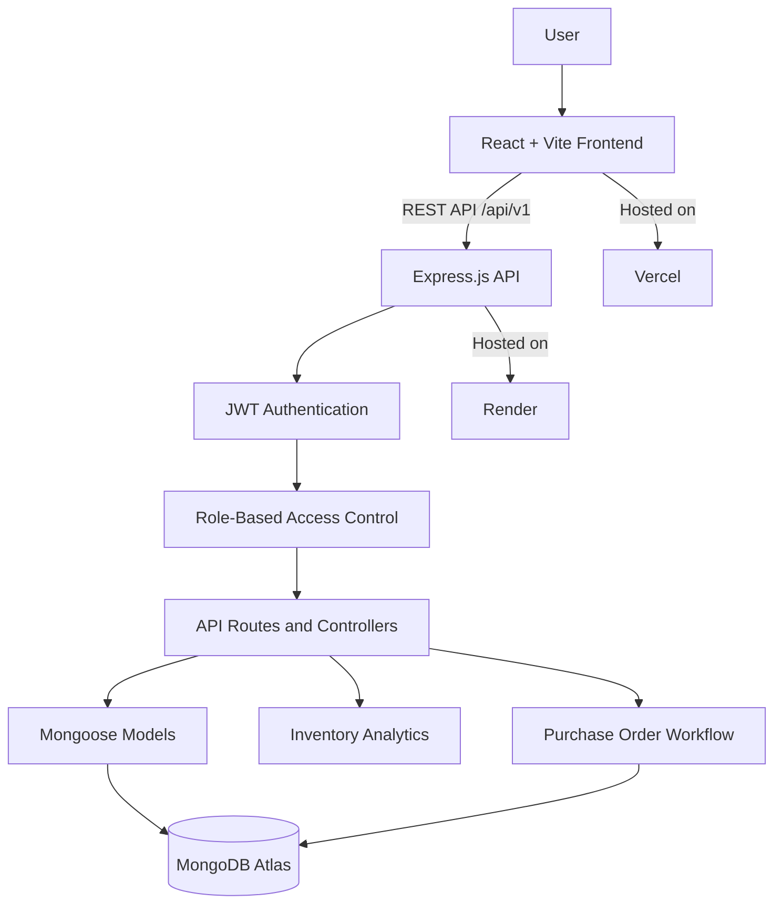

<div align="center">


# SUPPLY<span style="color:#16c991">PULSE</span>

### Supply Chain Intelligence

**Control Every Move. Smart Inventory. Smarter Decisions.**


<p>
  <a href="https://supply-pulse-nu.vercel.app/">
    
  </a>
  <a href="https://github.com/HarshKamboj25/SupplyPulse">
    
  </a>
</p>

<p>
  
  
  
  
  
  
  
  
</p>

</div>

---

## 🌐 Live Application

| Service | Link |
|---|---|
| **Frontend** | https://supply-pulse-nu.vercel.app/ |
| **Backend API** | https://supplypulse-api-dq4n.onrender.com/ |
| **API Health** | https://supplypulse-api-dq4n.onrender.com/api/v1/health |
| **Repository** | https://github.com/HarshKamboj25/SupplyPulse |

## ✨ What is SupplyPulse?

SupplyPulse is a multi-warehouse inventory management and intelligence platform designed to bring inventory operations into one connected workspace.

It helps teams manage products, warehouses, suppliers, purchase orders and stock visibility through a centralized dashboard.

From tracking inventory to receiving purchase orders and monitoring low-stock levels, SupplyPulse makes operational workflows easier to manage and understand.

## 🚀 Key Features

- **Inventory Management:** Create, view, update and manage product records.
- **Multi-Warehouse Operations:** Organize inventory across multiple warehouses.
- **Supplier Management:** Maintain supplier information and relationships.
- **Purchase Order Workflow:** Create, approve and receive purchase orders.
- **Stock Management:** Update stock safely when purchase orders are received.
- **Low-Stock Analytics:** Identify products that need replenishment.
- **Authentication:** JWT-based authentication and protected routes.
- **Role-Based Access Control:** Admin, Warehouse Manager and Procurement Officer roles.
- **Dashboard & Analytics:** Centralized visibility into inventory operations.
- **Input Validation:** Structured request validation and centralized error handling.

## 🧰 Technology Stack

| Layer | Technologies |
|---|---|
| Frontend | React 19, Vite, JavaScript |
| Routing | React Router |
| API Communication | Axios |
| UI & Visualization | CSS, Lucide React, Recharts |
| Backend | Node.js, Express.js |
| Database | MongoDB, Mongoose |
| Authentication | JSON Web Tokens, bcrypt |
| Security | Helmet, CORS, Express Rate Limit |
| Testing | Jest, Supertest, MongoDB Memory Server |
| Deployment | Vercel, Render |
| API Testing | Postman |

## 🏗️ Architecture



### Backend Structure

```text
SupplyPulse/
├── src/
│   ├── config/
│   ├── controllers/
│   ├── events/
│   ├── middleware/
│   ├── models/
│   ├── routes/
│   ├── scripts/
│   ├── utils/
│   ├── validators/
│   ├── app.js
│   └── server.js
├── frontend/
│   ├── public/
│   └── src/
│       ├── assets/
│       ├── components/
│       ├── context/
│       ├── hooks/
│       ├── pages/
│       └── services/
├── postman/
├── .env.example
├── package.json
└── README.md
```

## 🔐 Demo Access

Explore the deployed application using the dedicated demo account.

| Field | Demo Credentials |
|---|---|
| Email | `admin@supplypulse.dev` |
| Password | `VOID@supplypulse12345` |
| Access | Demo Administrator |

> **Demo account notice:** These are public demonstration credentials. Use this account only for exploring the demo environment. Do not store private or sensitive information in it.

[Open SupplyPulse Demo](https://supply-pulse-nu.vercel.app/)

## ⚙️ Run Locally

### Prerequisites

- Node.js 20 or later
- npm
- MongoDB Atlas account or local MongoDB
- Git

### 1. Clone the repository

```bash
git clone https://github.com/HarshKamboj25/SupplyPulse.git
cd SupplyPulse
```

### 2. Configure the backend

```powershell
Copy-Item .env.example .env
npm install
```

Configure the following variables in the root `.env` file:

```env
PORT=5000
NODE_ENV=development
MONGODB_URI=your_mongodb_connection_string
JWT_SECRET=your_secure_jwt_secret
JWT_EXPIRES_IN=1d
CLIENT_ORIGIN=http://localhost:5173
SEED_ADMIN_EMAIL=your_admin_email
SEED_ADMIN_PASSWORD=your_secure_admin_password
```

Use a strong JWT secret and a secure administrator password. Never commit `.env` or expose production credentials.

### 3. Start the backend

```powershell
npm run dev
```

The backend runs at:

`http://localhost:5000`

Health endpoint:

`http://localhost:5000/api/v1/health`

### 4. Configure the frontend

Open a second terminal:

```powershell
cd frontend
npm install
```

Create `frontend/.env` with:

```env
VITE_API_URL=http://localhost:5000/api/v1
```

### 5. Start the frontend

```powershell
npm run dev
```

Open the local Vite URL shown in your terminal, usually:

`http://localhost:5173`

### 6. Build the frontend

```powershell
npm run build
```

## 📡 API Overview

All versioned API routes use the `/api/v1` prefix.

| Method | Endpoint | Purpose |
|---|---|---|
| GET | `/api/v1/health` | API health check |
| POST | `/api/v1/auth/register` | Register a user |
| POST | `/api/v1/auth/login` | Authenticate a user |
| GET | `/api/v1/auth/me` | Get current user |
| GET | `/api/v1/products` | List products |
| POST | `/api/v1/products` | Create a product |
| GET | `/api/v1/warehouses` | List warehouses |
| POST | `/api/v1/warehouses` | Create a warehouse |
| GET | `/api/v1/suppliers` | List suppliers |
| POST | `/api/v1/suppliers` | Create a supplier |
| GET | `/api/v1/purchase-orders` | List purchase orders |
| POST | `/api/v1/purchase-orders` | Create a purchase order |
| PATCH | `/api/v1/purchase-orders/:id/approve` | Approve a purchase order |
| PATCH | `/api/v1/purchase-orders/:id/receive` | Receive a purchase order |
| GET | `/api/v1/analytics/low-stock` | Low-stock analytics |

Protected endpoints require a valid bearer token. Role permissions apply to write and approval operations.

## 📬 Postman Collection

The repository includes a Postman collection for testing the API.

**Collection:** [`postman/SupplyPulse.postman_collection.json`](postman/SupplyPulse.postman_collection.json)

Import it into Postman, configure the API base URL and authentication token, and explore the available requests.

## 🔒 Security & Reliability

- Password hashing with bcrypt.
- JWT-based authentication.
- Role-based authorization.
- Environment-based secrets and configuration.
- Helmet security headers.
- CORS configuration.
- Express rate limiting.
- Request validation and centralized error handling.
- Transaction-safe purchase order receiving.
- Protection against concurrent duplicate receiving.
- Non-destructive database seeding.

## 🧪 Testing

The backend test suite uses Jest and Supertest.

Run the tests from the repository root:

```powershell
npm test
```

## ☁️ Deployment

| Component | Platform |
|---|---|
| React frontend | Vercel |
| Express API | Render |
| Database | MongoDB Atlas |

The frontend communicates with the deployed API through its configured API base URL.

## 🗺️ Roadmap

- [ ] Automated CI checks for frontend and backend.
- [ ] Expanded analytics and reporting.
- [ ] More comprehensive API documentation.
- [ ] Additional integration and end-to-end tests.
- [ ] Enhanced operational insights.

## 🤝 Contributing

Contributions, suggestions and issue reports are welcome.

1. Fork the repository.
2. Create a feature branch.
3. Commit your changes.
4. Open a pull request with a clear description.

## 👨‍💻 Project

**SupplyPulse**
*Supply Chain Intelligence*

Built to make inventory operations more connected, visible and manageable.

<div align="center">

### Control Every Move.

**SUPPLY CHAIN INTELLIGENCE**

<a href="https://supply-pulse-nu.vercel.app/">Live Application</a> ·
<a href="https://github.com/HarshKamboj25/SupplyPulse">GitHub Repository</a>

</div>